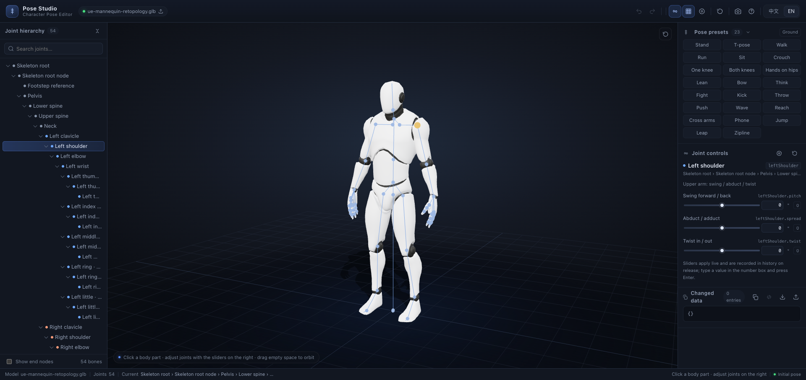

# Pose Studio · Character Pose Editor

[中文](README.md) | English



A real-time character pose editor built with **Vue 3 + Three.js**. Bones are not edited through X/Y/Z values — you edit them semantically as "joint + motion" (`leftShoulder.spread`, `leftElbow.bend`, …), and 23 pose presets are ready to apply.

The pose algorithm is identical to **storyai-3d-director-desk-main**: with the same `controls` and the same model, both projects produce bone-for-bone identical poses (`npm run verify:rig` measures a maximum deviation of 0.0007°, i.e. the rounding precision of the bind snapshot).

Bundled sample model: UE Mannequin (67 bones), the same GLB the reference project ships.

The interface is bilingual (中文 / English). Use the `中文 | EN` switch in the top-right corner of the toolbar; the choice is stored in `localStorage` and restored on the next visit.

## Features

- **Semantic joint editing**: a body-part tree on the left (Pelvis / Spine / Left shoulder / Left elbow / Left hip / Left knee …) and motion sliders for the selected part on the right (raise / lower the arm, swing forward / back, twist in / out, bend the elbow, bend the knee, flex the foot, nod the head, turn the body …). No X/Y/Z and no raw bone names anywhere.
- **Pose presets**: Stand, T-pose, Walk, Run, Sit, Crouch, One knee, Both knees, Hands on hips, Lean, Bow, Think, Fight, Kick, Throw, Push, Wave, Reach, Cross arms, Phone, Jump, Leap, Zipline. Applying one automatically plants the character on the ground.
- **One-hand gestures**: when `leftHand` / `rightHand` (left / right wrist) is selected, a gesture row appears under "Joint controls" — Default, Hold, Fist, V sign, Palm, OK, Thumb up, Middle finger, Pinky. A gesture only touches the 15 finger bones of that hand; the arm and body keep their pose, and the whole thing is recorded as a single history step.
- **Click to select in the viewport**: clicking a body part selects the nearest joint; you can also click the skeleton joints or pick a part precisely in the tree on the left. The viewport is for selecting and looking — every numeric change happens in the right panel.
- **Changed data panel**: the bottom of the right column lists every edited joint as live JSON (keys match the preset format) and can copy, download or re-import it in one click.
- **Mirror pose**: flips the current pose left/right in one click (a real reflection in model space, correct even when left and right bones have different axes).
- **Undo / redo**: slider release, Enter in a number box, applying a preset, importing, mirroring and grounding all become history steps.
- **Screenshot export**: the skeleton overlay is hidden automatically, so the PNG is a clean character shot.
- **Load your own model**: click the model name in the top bar to load a local `.glb` (it must contain a `SkinnedMesh`); the model is normalized to 1.8 m tall with its feet on the floor.
- **Shortcuts**: `F` focus the selected joint, `B` skeleton, `G` ground grid, `Esc` clear selection, `⌘/Ctrl+Z` undo, `⇧⌘/Ctrl+Z` redo, `?` help.

## Quick start

```bash
npm install
npm run dev        # http://localhost:5173
```

Build and preview:

```bash
npm run build
npm run preview
```

> The model lives at `public/models/ue-mannequin-retopology.glb` (copied as-is at build time). To change the default model, replace that file and update `MODEL_NAME` at the top of `src/core/PoseEditor.js`.

## Workflow

1. Click the character's left shoulder or any other part in the viewport, or pick a part in the "Joint hierarchy" tree on the left (drag empty space to orbit, scroll to zoom).
2. Drag a semantic slider such as "raise arm / lower arm" in "Joint controls" on the right, or type a value into the number box and press Enter; you can also apply a "Pose preset" in one click.
3. "Changed data" at the bottom of the right column lists every edit live; copy or download it as a pose JSON.
4. "Mirror" makes the pose symmetrical; "⌘Z" undoes; the camera button exports a PNG screenshot.

## Semantic controls and sign conventions

Every body part has a semantic id, and each motion is written as `part.motion`, for example:

| Part | Motions | Meaning |
| --- | --- | --- |
| `body` (pelvis) | `pitch` / `yaw` / `roll` / `offsetY` | lean forward-back, turn, tilt sideways, whole-body height offset (m) |
| `spine` / `torso` / `neck` / `head` | `pitch` / `yaw` / `roll` | bend / turn / tilt of the spine, neck and head |
| `leftShoulder` / `rightShoulder` | `spread` / `pitch` / `twist` | raise-lower, swing forward-back, twist in-out |
| `leftElbow` / `rightElbow` | `bend` | bend the elbow |
| `leftHand` / `rightHand` | `roll` / `pitch` / `twist` | wrist roll / flex-extend / adduct-abduct |
| `leftHip` / `rightHip` | `pitch` / `spread` / `twist` | raise the thigh / swing back, abduct-adduct, twist in-out |
| `leftKnee` / `rightKnee` | `bend` | bend the knee |
| `leftFoot` / `rightFoot` | `pitch` / `roll` / `twist` | point-flex, roll in-out, twist in-out |
| `leftClavicle` / `rightClavicle` | `spread` / `pitch` | shrug-drop, protract-retract |
| Fingers (one bone per segment) | `bend` | written as `leftFinger1_1.bend`; 1 = base, 2 = proximal, 3 = distal |

**The values mean the same as in storyai**: each control is converted to a local Euler angle and composed exactly like storyai's `ue4ShoulderRotation` and friends. Both sides share one formula, and the sign of the value picks the direction:

| Joint | Euler (x, y, z) | storyai function |
| --- | --- | --- |
| `body` / `spine` / `torso` | `[yaw, roll, -pitch]` | `ue4SpineRotation` |
| `neck` / `head` | `[yaw, roll, pitch]` | `ue4HeadRotation` |
| `leftShoulder` / `rightShoulder` | `[twist, spread, -pitch]` | `ue4ShoulderRotation` |
| `leftHip` / `rightHip` | `[twist, -spread, pitch]` | `ue4HipRotation` |
| `leftElbow` / `rightElbow`, knees, toes, fingers | `[0, 0, -bend]` | `ue4LimbBendRotation` |
| `leftHand` / `rightHand`, ankles | `[twist, roll, pitch]` | `ue4HandRotation` / `ue4FootRotation` |
| Clavicles (not in storyai; extended in the same shoulder style) | `[0, spread, -pitch]` | — |

All angles are clamped to **±180°** before they are applied (`LIMIT` in `semanticRig.js`, shared by the slider range and the clamp).
storyai's default profile (`getBodyTypePoseLimit`) is ±90°, which would clip the values in `pose.js` above 90
(e.g. 126 in a kneeling pose) down to 90; this project relaxes the limit to ±180°, so those values apply as written.

The same anatomical motion is written with opposite values on the left and right side:

```js
// T-pose: left arm spread -70, right arm +70 (matches storyai's t-pose preset)
{ 'leftShoulder.spread': -70, 'rightShoulder.spread': 70,
  'leftShoulder.pitch': 15,  'rightShoulder.pitch': 15,
  'leftElbow.bend': 10,      'rightElbow.bend': 10 }
```

`MANNEQUIN_POSE_PRESETS` in `src/pose.js` is written this way; the numbers are copied verbatim from
storyai's `mannequinPosePresets.ts` and can be fed straight into `applySemanticMap()`.

## Pose file format

```json
{
  "format": "pose-studio",
  "version": 1,
  "createdAt": "2025-01-01T00:00:00.000Z",
  "model": "ue-mannequin-retopology.glb",
  "bones": {
    "Bip001_L_UpperArm_08": {
      "r": [-0.00229, -0.40192, -0.29116, 0.86815],
      "t": [-5.93089, 0, 0]
    }
  }
}
```

- `bones` is keyed by bone name so it travels across engines;
- `r` is the local quaternion `[x, y, z, w]`, `t` is the local position `[x, y, z]` (parent bone space);
- on import bones are matched by name; if nothing matches you get a warning.

Exported files also carry two human-readable sections (import still trusts the `bones` snapshot, so these can be ignored):

- `controls`: semantic key/value pairs such as `{"leftShoulder.spread": -70}`, in the same format as storyai's presets and directly interchangeable;
- `commands`: a bone command stream `[{ bone, kind: "rotate", axis: [x,y,z], deg }, { bone, kind: "move", move: [...] }]`;
  replaying it parent-first restores the same pose, which makes it easy to feed into another engine.

## Project structure

```
src/
├─ App.vue                 # layout, loading overlay, toasts, shortcuts
├─ store.js                # reactive state + every UI action (selection, history, import/export)
├─ i18n.js                 # 中文 / English UI strings and label helpers
├─ style.css               # design tokens and shared controls
├─ pose.js                 # 23 pose presets + 9 one-hand gestures (semantic control tables)
├─ core/
│  ├─ PoseEditor.js        # Three.js engine: rendering, picking, skeleton overlay, mirror, history, grounding, screenshots
│  ├─ semanticRig.js       # bone → joint/motion mapping and quaternion ↔ semantic angle conversion
│  └─ poseUtils.js         # pure helpers for pose snapshots / serialization
└─ components/
   ├─ TopBar.vue           # toolbar, load a local model, language switch
   ├─ BoneTree.vue         # joint hierarchy (search / expand / end nodes)
   ├─ Inspector.vue        # joint sliders + pose presets
   ├─ PoseJson.vue         # changed-data JSON panel (including command-stream copy)
   ├─ StatusBar.vue        # status bar
   ├─ HelpDialog.vue       # shortcut reference
   └─ Icon.vue             # inline SVG icons
```

Labels are stored bilingually in the data itself: every joint, motion, preset and gesture has a Chinese
`label` / `hint` plus a `labelEn` / `hintEn`; `i18n.js` picks the right one for the current language.

## Implementation notes

- **Picking**: raycast against the joint spheres first; otherwise raycast the skinned mesh (Three.js applies the bone deformation), then find the nearest bone by "distance to the bone segment", so clicking the middle of the arm selects the whole bone.
- **Semantic conversion**: `bone.quaternion = bind pose · Euler(x, y, z)` (three.js default `XYZ` order), matching storyai's `applyUE4RestPoseAndRig` line for line. Slider values are read back with `Euler.setFromQuaternion(delta, 'XYZ')`, and writing one value keeps the current values of the other motions, so sliders never overwrite each other. Bind pose = rest pose · neutral offset (upper arms ±25°, forearms +25°); see the comment at the top of `semanticRig.js`.
- **Grounding**: CPU-skins a 1/9 sample of the mesh vertices, takes the lowest point and corrects the pelvis height, so presets never sink into or float above the floor.
- **Mirror**: reflects each bone's world transform about the YZ plane in model space with `M' = R·M·R`, converts it back to the parent's local transform and applies it bone by bone in hierarchy order.
- **Rendering**: ACES tone mapping, RoomEnvironment lighting and soft shadows; a ground grid plus a shadow-receiving plane; the model is normalized to 1.8 world units.
- **Data flow**: Three.js objects never enter Vue's reactivity. The engine pushes selection / transform / history state to `store` through callbacks, and the UI only reads plain data.

## Consistency with storyai-3d-director-desk-main

The reference project applies a pose in three levels, post-multiplied onto each bone's local quaternion
(`ue4MannequinPoseApplication.applyUE4RestPoseAndRig`):

```
rest pose → neutral offset (upper arms ±25°, forearms +25°) → Euler(x, y, z) derived from the semantic controls
```

This project bakes the first two levels into the "bind pose" (applied once when the model loads, then re-snapshotted), so the slider stage is just
`bone.quaternion = bind pose · Euler(x, y, z)`; `decomposeJoint` is its exact inverse
(`Euler.setFromQuaternion(bind⁻¹ · cur, 'XYZ')`).

`npm run verify:rig` does not re-state the formulas: it loads storyai's two source files **verbatim** through Vite
(`/@fs/<storyai>/src/editor/runtime/ue4Mannequin/ue4MannequinPoseApplication.ts`), runs the same GLB with the same `controls`
and then compares quaternions bone by bone. Measured:

```
A. 20 presets vs applyUE4RestPoseAndRig     max deviation 0.0007° (= 5-decimal rounding of the snapshot)
B. 200 random control sets (within ±90°)    max deviation 0.0007°
C. Clamp ±180°                              200 → 180, -200 → -180
D. Slider round trip compose → decompose    0.0000°
```

The only two known differences from the reference project (neither is in the pose algorithm itself):

| Item | storyai | This project | Note |
| --- | --- | --- | --- |
| Unit of `body.offsetY` | metres × 39.37, pushed into the pelvis parent's z axis | metres on world Y | This project normalizes the model to 1.8 m tall, so world-Y translation cannot drift with model scale; the two agree within 5 mm |
| Body type | mannequin / slim / child profiles with bone scaling | none | Only affects the 1.02× thickness of pelvis/spine, not the pose |

## Development self-checks

Requires Google Chrome on the machine:

```bash
npm run dev              # in another terminal
npm run verify           # functional check: picking, semantic round trip, mirror, undo, grounding of the presets, changed-data panel
npm run verify:ui        # UI check: no X/Y/Z or raw bone names anywhere, sliders and presets work
npm run verify:shell     # shell check: no transform mode / axis switch, no viewport gizmos, no pose library, live JSON panel
npm run verify:rig       # load storyai's sources verbatim and compare quaternions bone by bone (requires storyai-3d-director-desk-main in the repo)
npm run audit:presets    # print hand positions, lowest point and other numbers for each preset
npm run smoke            # production-build smoke test (run npm run build && npm run preview first)
npm run shots            # write screenshots to /tmp/pose-shots
```

## Known limitations

- Only `.glb` / `.gltf` models with a skeleton (`SkinnedMesh`) are supported; a `.gltf` that references external textures/binaries must be packed into a `.glb` first.
- Euler angles are decomposed in `XYZ` order (same as storyai); `spread` near ±90° on shoulders/hips hits gimbal lock and the other two motions become sensitive. storyai has the same limitation.
- The semantic controls, local axes and signs are calibrated for the bundled UE mannequin; a model with very different bone orientations may need re-calibration (all of it lives in `semanticRig.js`).
- `verify:rig` depends on the `storyai-3d-director-desk-main/` directory being present; without it the comparison is skipped.
- Fingers only expose a single "bend" axis per segment.
- Pose files and models are tied together by bone names, so an old pose may not apply to a different model.
